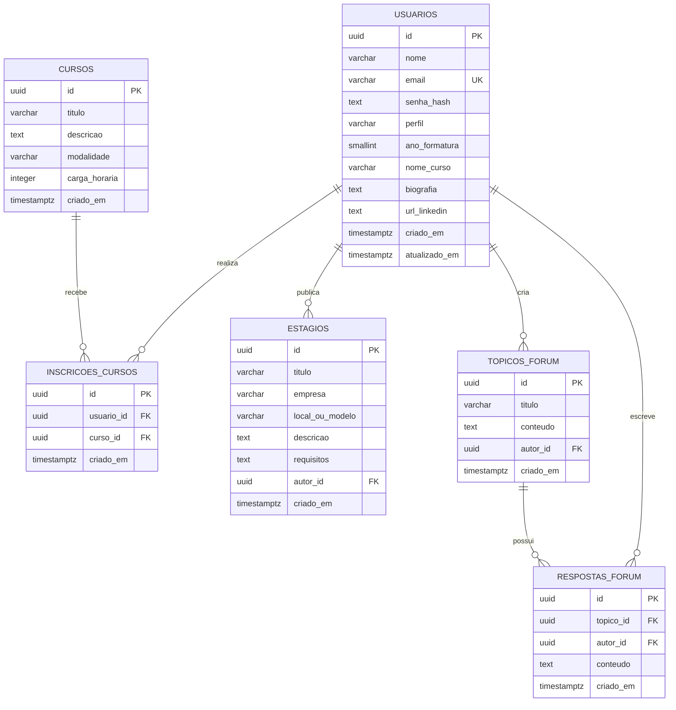

# Estrutura do Banco de Dados — Portal de Egressos FAETERJ

Este documento descreve a modelagem relacional, as regras de integridade e os procedimentos de criação do banco de dados do **Portal de Egressos FAETERJ**, desenvolvido pelos alunos de Engenharia de Software da **UBM** na disciplina de *Práticas Extensionistas Integradoras III*.

---

## 1. Visão Geral da Arquitetura de Dados

* **SGBD:** PostgreSQL (hospedado na plataforma **Neon** — plano gratuito).
* **Estratégia de acesso:** SQL puro (sem ORM), com consultas parametrizadas no back-end.
* **Ambientes (Branches Neon):**
  * `main`: base principal/produção.
  * `dev`: base de desenvolvimento e testes da equipe.
* **Padrão de nomenclatura:** identificadores de tabelas, colunas, restrições (*constraints*) e índices em português, sem acentos ou espaços (`snake_case`).
* **Arquivos relacionados:**
  * [`database/schema.sql`](../database/schema.sql): script DDL de criação das tabelas, restrições e índices.
  * [`database/seed.sql`](../database/seed.sql): script DML com dados iniciais de exemplo para o ambiente de desenvolvimento.

---

## 2. Diagrama Entidade-Relacionamento (DER)

---

## 3. Dicionário de Dados

### 3.1. `usuarios`
Armazena os dados cadastrais e de autenticação dos egressos, alunos e professores da FAETERJ.

| Coluna | Tipo | Restrições | Descrição |
| :--- | :--- | :--- | :--- |
| `id` | `UUID` | `PRIMARY KEY`, `DEFAULT gen_random_uuid()` | Identificador único do usuário. |
| `nome` | `VARCHAR(150)` | `NOT NULL` | Nome completo do usuário. |
| `email` | `VARCHAR(180)` | `NOT NULL`, `UNIQUE` | E-mail institucional ou pessoal usado no login. |
| `senha_hash` | `TEXT` | `NOT NULL` | Hash criptográfico da senha (gerado pelo back-end). |
| `perfil` | `VARCHAR(30)` | `NOT NULL`, `DEFAULT 'egresso'`, `CHECK` | Papel no portal: `'egresso'`, `'aluno'` ou `'professor'`. |
| `ano_formatura` | `SMALLINT` | Nullable | Ano de conclusão (ou previsão de conclusão) do curso. |
| `nome_curso` | `VARCHAR(120)` | Nullable | Curso vinculado na FAETERJ. |
| `biografia` | `TEXT` | Nullable | Resumo profissional ou acadêmico do usuário. |
| `url_linkedin` | `TEXT` | Nullable | Link para o perfil do LinkedIn. |
| `criado_em` | `TIMESTAMPTZ` | `NOT NULL`, `DEFAULT NOW()` | Data e hora de criação do registro. |
| `atualizado_em` | `TIMESTAMPTZ` | `NOT NULL`, `DEFAULT NOW()` | Data e hora da última atualização do perfil. |

* **Regra de integridade (`chk_perfil_usuario`):** aceita exclusivamente os valores `'egresso'`, `'aluno'` ou `'professor'`.

---

### 3.2. `cursos`
Armazena os cursos de extensão, capacitação ou atualização exibidos na página de cursos.

| Coluna | Tipo | Restrições | Descrição |
| :--- | :--- | :--- | :--- |
| `id` | `UUID` | `PRIMARY KEY`, `DEFAULT gen_random_uuid()` | Identificador único do curso. |
| `titulo` | `VARCHAR(180)` | `NOT NULL` | Nome do curso. |
| `descricao` | `TEXT` | `NOT NULL` | Ementa resumida e objetivos do curso. |
| `modalidade` | `VARCHAR(50)` | Nullable | Formato de oferta (`Presencial`, `EAD`, `Hibrido`). |
| `carga_horaria` | `INTEGER` | Nullable | Carga horária total em horas. |
| `criado_em` | `TIMESTAMPTZ` | `NOT NULL`, `DEFAULT NOW()` | Data e hora de cadastro do curso. |

---

### 3.3. `inscricoes_cursos`
Tabela associativa (N:N) que registra o interesse ou inscrição de usuários nos cursos disponíveis.

| Coluna | Tipo | Restrições | Descrição |
| :--- | :--- | :--- | :--- |
| `id` | `UUID` | `PRIMARY KEY`, `DEFAULT gen_random_uuid()` | Identificador único da inscrição. |
| `usuario_id` | `UUID` | `NOT NULL`, `FK -> usuarios(id) ON DELETE CASCADE` | Usuário inscrito. |
| `curso_id` | `UUID` | `NOT NULL`, `FK -> cursos(id) ON DELETE CASCADE` | Curso selecionado. |
| `criado_em` | `TIMESTAMPTZ` | `NOT NULL`, `DEFAULT NOW()` | Data e hora da inscrição. |

* **Regra de integridade (`uq_usuario_curso`):** chave única composta `(usuario_id, curso_id)` que impede inscrições duplicadas do mesmo usuário no mesmo curso.

---

### 3.4. `estagios`
Armazena oportunidades de estágio e vagas divulgadas no portal.

| Coluna | Tipo | Restrições | Descrição |
| :--- | :--- | :--- | :--- |
| `id` | `UUID` | `PRIMARY KEY`, `DEFAULT gen_random_uuid()` | Identificador único da vaga. |
| `titulo` | `VARCHAR(180)` | `NOT NULL` | Título do cargo ou estágio. |
| `empresa` | `VARCHAR(150)` | `NOT NULL` | Nome da empresa ou organização ofertante. |
| `local_ou_modelo` | `VARCHAR(120)` | Nullable | Localidade ou modelo de trabalho (`Remoto`, `Presencial`, `Hibrido`). |
| `descricao` | `TEXT` | `NOT NULL` | Atividades e detalhes da oportunidade. |
| `requisitos` | `TEXT` | Nullable | Conhecimentos e pré-requisitos desejados. |
| `autor_id` | `UUID` | `FK -> usuarios(id) ON DELETE SET NULL` | Usuário que publicou a vaga (mantém a vaga caso o autor seja removido). |
| `criado_em` | `TIMESTAMPTZ` | `NOT NULL`, `DEFAULT NOW()` | Data e hora de publicação. |

---

### 3.5. `topicos_forum`
Armazena as discussões iniciadas pela comunidade no fórum.

| Coluna | Tipo | Restrições | Descrição |
| :--- | :--- | :--- | :--- |
| `id` | `UUID` | `PRIMARY KEY`, `DEFAULT gen_random_uuid()` | Identificador único do tópico. |
| `titulo` | `VARCHAR(200)` | `NOT NULL` | Título da discussão. |
| `conteudo` | `TEXT` | `NOT NULL` | Texto principal da postagem. |
| `autor_id` | `UUID` | `NOT NULL`, `FK -> usuarios(id) ON DELETE CASCADE` | Autor do tópico. |
| `criado_em` | `TIMESTAMPTZ` | `NOT NULL`, `DEFAULT NOW()` | Data e hora de abertura do tópico. |

---

### 3.6. `respostas_forum`
Armazena os comentários e respostas vinculados a cada tópico do fórum.

| Coluna | Tipo | Restrições | Descrição |
| :--- | :--- | :--- | :--- |
| `id` | `UUID` | `PRIMARY KEY`, `DEFAULT gen_random_uuid()` | Identificador único da resposta. |
| `topico_id` | `UUID` | `NOT NULL`, `FK -> topicos_forum(id) ON DELETE CASCADE` | Tópico ao qual a resposta pertence. |
| `autor_id` | `UUID` | `NOT NULL`, `FK -> usuarios(id) ON DELETE CASCADE` | Autor da resposta. |
| `conteudo` | `TEXT` | `NOT NULL` | Conteúdo da resposta. |
| `criado_em` | `TIMESTAMPTZ` | `NOT NULL`, `DEFAULT NOW()` | Data e hora do envio. |

---

## 4. Índices Criados

Para otimizar consultas de listagem cronológica e junções por chave estrangeira, foram definidos os seguintes índices:

* `idx_estagios_criado_em`: ordenação decrescente de vagas por data de publicação (`estagios(criado_em DESC)`).
* `idx_topicos_forum_criado_em`: ordenação decrescente de tópicos do fórum (`topicos_forum(criado_em DESC)`).
* `idx_respostas_forum_topico_id`: recuperação ordenada das respostas de um tópico (`respostas_forum(topico_id, criado_em ASC)`).
* `idx_inscricoes_cursos_usuario_id`: consulta rápida dos cursos em que um usuário está inscrito (`inscricoes_cursos(usuario_id)`).

---

## 5. Como Reproduzir o Banco no Neon

1. Acesse o console do **Neon** (`console.neon.tech`) e selecione o projeto e a branch desejada (`dev` ou `main`).
2. Abra o **SQL Editor**.
3. Execute primeiro o script [`database/schema.sql`](../database/schema.sql) para criar a extensão `pgcrypto`, as 6 tabelas, a constraint `chk_perfil_usuario` e os índices.
4. *(Opcional — ambiente `dev`)* Execute o script [`database/seed.sql`](../database/seed.sql) para popular o banco com usuários, cursos, estágios e tópicos iniciais de teste.
5. Configure a variável de ambiente `DATABASE_URL` no back-end utilizando a *Connection String* do Neon com `sslmode=require`.